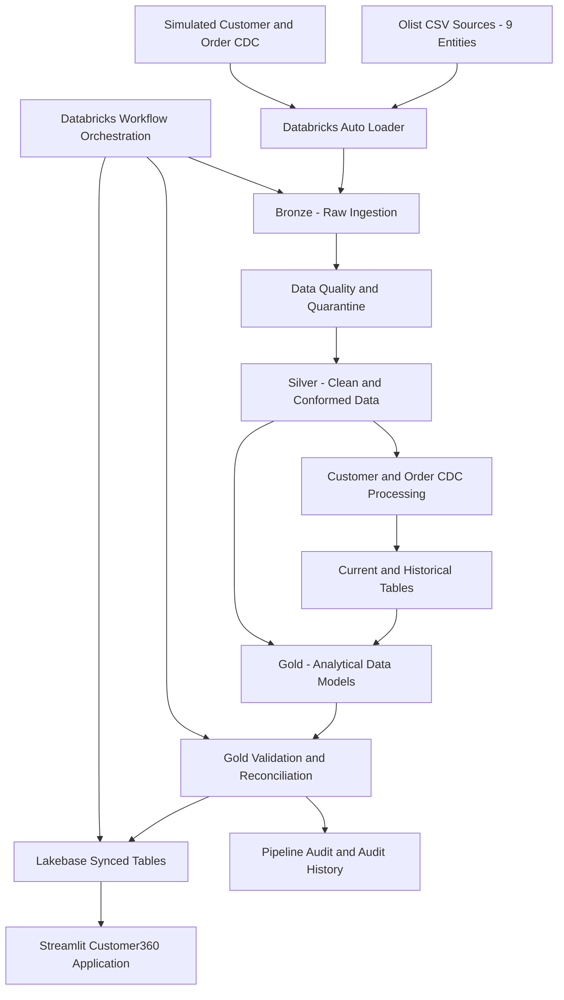
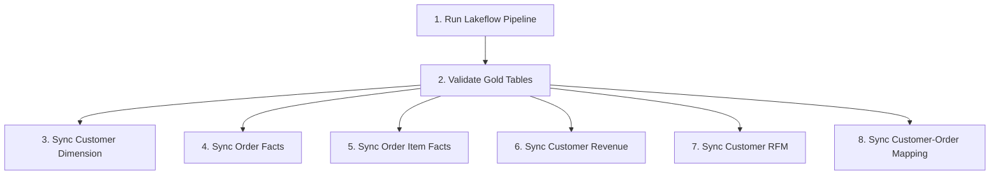

# Customer360 CDC Operational Platform

### End-to-End Data Engineering | Databricks Lakeflow | PySpark | Delta Lake | CDC | SCD Type 2 | Lakebase | Streamlit

An end-to-end Customer360 data engineering platform built using Databricks, Apache Spark, Delta Lake, and PostgreSQL.

The platform ingests Brazilian Olist e-commerce data, applies data quality controls, simulates customer and order Change Data Capture (CDC), maintains current and historical records, builds analytical Gold datasets, and serves customer intelligence through a Streamlit application backed by Databricks Lakebase.

Beyond ETL, the project demonstrates operational engineering practices including automated validation, workflow dependencies, audit logging, failure simulation, and recovery.

---

## 1. Architecture



### Technology Stack

| Layer | Technology |
|---|---|
| Cloud data platform | Databricks |
| Processing | Apache Spark, PySpark |
| Ingestion | Databricks Auto Loader |
| Pipeline framework | Lakeflow Spark Declarative Pipelines |
| Storage | Delta Lake |
| Governance | Unity Catalog |
| CDC processing | Simulated CDC, SCD Type 1 and Type 2 |
| Data quality | Validation, deduplication, quarantine |
| Analytics | Gold dimensional and fact models |
| Serving | Databricks Lakebase, PostgreSQL |
| Application | Python, Streamlit, psycopg |
| Orchestration | Databricks Jobs |
| Version control | Git and GitHub |

---

## 2. Business Problem

E-commerce customer data is distributed across orders, payments, products, sellers, reviews, and other operational entities.

Building a unified customer view requires more than joining tables.

The platform must:

- Ingest multiple source entities reliably.
- Detect and handle invalid or duplicate records.
- Maintain customer and order history.
- Support incremental processing.
- Reconcile financial values across processing layers.
- Provide query-ready analytical datasets.
- Prevent invalid data from reaching downstream serving systems.
- Support failure investigation and controlled recovery.

This project addresses these requirements through a modular lakehouse architecture.

---

## 3. Dataset

The project uses the Brazilian E-Commerce Public Dataset by Olist.

### Source Entities

| Entity | Original Source Rows |
|---|---:|
| Customers | 99,441 |
| Orders | 99,441 |
| Order Items | 112,650 |
| Payments | 103,886 |
| Reviews | 104,162 |
| Products | 32,951 |
| Sellers | 3,095 |
| Geolocation | 1,000,163 |
| Category Translation | 71 |

The dataset contains historical e-commerce transactions, customer information, payment records, product information, and delivery-related data.

**Important:** The original Olist dataset is not a native CDC feed. Customer and order changes are simulated to demonstrate CDC processing, ordering, historical tracking, and delete handling.

---

## 4. Bronze Layer — Incremental Ingestion

The Bronze layer ingests source CSV files through Databricks Auto Loader.

### Features

- Schema-driven ingestion for nine source entities.
- Centralized ingestion configuration.
- Entity-specific CSV reader options.
- File metadata enrichment.
- Ingestion timestamps.
- Source system identification.
- Record hashing.
- Rescued data handling for unexpected or malformed fields.

### Implementation

The ingestion framework uses reusable Python components:

- `config/ingestion_config.py`
- `config/schemas.py`
- `framework/auto_loader_reader.py`
- `framework/metadata_enricher.py`
- `framework/record_hasher.py`

Bronze ingestion definitions are maintained in:

`bronze/bronze_ingestion.py`

---

## 5. Data Quality Framework

The platform applies entity-specific quality checks before producing trusted downstream datasets.

### Quality Controls

- Required-field validation.
- Schema and datatype checks.
- Duplicate detection.
- Business-key validation.
- Record-level quality classification.
- Quarantine of rejected records.
- Financial consistency checks.

Quality rules are maintained separately from ingestion logic.

### Key Modules

- `config/quality_rules.py`
- `framework/quality_validator.py`
- `quality/`

The design separates source ingestion from business data validation.

---

## 6. CDC and SCD Processing

Customer and order change events are simulated to demonstrate CDC processing without requiring a live transactional database.

### Customer CDC

Customer CDC is keyed by:

`customer_unique_id`

Tracked customer attributes include:

- ZIP code.
- City.
- State.

The implementation maintains both the latest customer state and historical customer versions.

### Order CDC

Order CDC models changes in order lifecycle states and supports historical tracking.

The implementation includes:

- Simulated order lifecycle events.
- CDC event sequencing.
- Current-state records.
- Historical versions.
- Delete-event handling.

### Current and Historical Tables

| Entity | Current State | Historical State |
|---|---|---|
| Customer | `silver.customer_current` | `silver.customer_history` |
| Order | `silver.order_current` | `silver.order_history` |

The current tables provide the latest active representation, while the history tables preserve earlier versions.

### SCD Type 1 vs SCD Type 2

**SCD Type 1:** Maintains the current value without exposing previous attribute versions in the current-state table.

**SCD Type 2:** Preserves historical versions with effective boundaries and active-record indicators.

The project validates historical boundaries, business-key uniqueness, and consistency between current and active historical records.

---

## 7. Silver Layer

The Silver layer produces cleaned, standardized, and business-conformed datasets.

### Core Responsibilities

- Deduplication.
- Data type standardization.
- Data quality enforcement.
- Customer and order CDC processing.
- Current and historical state management.
- Reference data preparation.
- Order item and payment validation.

The modular transformations are organized under:

`silver/`

Supporting reusable processing logic is maintained under:

`framework/`

---

## 8. Gold Layer — Customer360 Analytics

The Gold layer provides six analytical datasets.

### Validated Gold Tables

| Gold Table | Validated Rows |
|---|---:|
| `dim_customer_360` | 96,096 |
| `fact_orders` | 99,441 |
| `fact_order_items` | 112,649 |
| `customer_revenue_summary` | 96,096 |
| `customer_rfm` | 96,096 |
| `customer_order_mapping` | 99,446 |

### Analytical Capabilities

**Customer Dimension**

Provides a consolidated customer profile and location information.

**Order Facts**

Provides order-level measures, payment totals, order statuses, and fulfillment-related information.

**Order Item Facts**

Provides product, seller, item price, and freight information.

**Customer Revenue Summary**

Provides customer-level order and payment metrics.

**RFM Analysis**

Calculates customer recency, frequency, monetary values, and segmentation attributes.

**Customer-Order Mapping**

Connects customer identities with their associated orders.

### Financial Reconciliation

The validated Silver and Gold payment totals matched exactly:

**BRL 16,008,683.49**

Additional order-item reconciliation checks confirmed:

| Measure | Validated Amount (BRL) |
|---|---:|
| Item price | 13,591,403.80 |
| Freight | 2,251,889.61 |
| Combined total | 15,843,293.41 |

These checks help detect missing records, duplication, or incorrect financial transformations.

---

## 9. Lakebase Serving Layer

The platform uses Databricks Lakebase, a managed PostgreSQL-compatible database, as the serving layer.

Six Gold datasets are exposed through managed synced tables.

### Serving Design

```text
Databricks Gold Tables
         |
         v
Lakebase Managed Synced Tables
         |
         v
PostgreSQL Queries
         |
         v
Streamlit Customer360 Application
```

This separates analytical data processing from interactive application queries.

The application reads from Lakebase rather than directly querying the Spark processing pipeline.

---

## 10. Streamlit Customer360 Application

The Streamlit application provides an interactive interface for exploring customer information.

### Features

- Total customer count.
- Total order count.
- Total payment value.
- Customer search.
- Customer profile.
- Lifetime payment value.
- Total order count.
- RFM segmentation.
- Customer order history.
- Order item drill-down.

### Security Design

The application uses the Databricks SDK to generate a short-lived database credential for Lakebase authentication.

Additional safeguards include:

- Environment-based database configuration.
- PostgreSQL SSL connection.
- Parameterized SQL queries.
- Read-only database session.
- Generic user-facing error messages.
- Query result caching.

Application source files are maintained under:

`app/`

---

## 11. Workflow Orchestration

The operational workflow is implemented through Databricks Jobs.

### Eight-Task Workflow



### Operational Controls

- Validation gate before serving-table synchronization.
- Six parallel Lakebase sync tasks.
- Retry configuration for sync operations.
- Failure notifications.
- Maximum concurrent job runs set to one.
- Controlled failure simulation.
- Recovery from failed workflow tasks.

A failed Gold validation prevents downstream sync tasks from proceeding.

---

## 12. Audit Logging and Monitoring

The platform maintains operational audit records in Unity Catalog.

### Audit Tables

`dev_customer360.ops.pipeline_audit`

Stores the latest pipeline validation status.

`dev_customer360.ops.pipeline_audit_history`

Stores an append-only history of validation attempts.

### Audit Capabilities

- Pipeline validation status.
- Attempt-level identifiers.
- Failure and success tracking.
- Historical execution evidence.
- Operational troubleshooting support.

Each validation attempt receives a unique identifier.

The audit history preserves failed attempts even after a subsequent successful recovery.

---

## 13. Failure Simulation and Recovery

The platform includes a controlled failure simulation mechanism.

A Databricks job parameter is used:

`simulate_failure = false`

When enabled for testing, the validation task intentionally fails.

### Tested Recovery Scenario

1. Run the workflow with controlled failure enabled.
2. Confirm Gold validation fails.
3. Confirm downstream Lakebase synchronization is blocked.
4. Correct the failure condition.
5. Repair the failed workflow tasks.
6. Confirm successful completion.
7. Verify failure and success records remain in audit history.

The recovery test demonstrated that failed downstream work could be repaired without rerunning the already successful Lakeflow task.

---

## 14. Data Validation Results

The platform underwent checks for CDC integrity, historical consistency, financial reconciliation, and stable incremental execution.

### CDC Validation

- Customer current-state and active-history reconciliation passed.
- Order current-state and active-history reconciliation passed.
- No duplicate active records were detected in the validated checks.
- No invalid historical version boundaries were detected.
- Simulated delete scenarios were verified.

### Incremental Stability

A subsequent pipeline run with unchanged source inputs preserved the expected table counts.

### Financial Integrity

- Silver-to-Gold payment totals reconciled.
- Order-item business keys reconciled.
- Item price and freight values reconciled.
- No row-level financial mismatches were found in the validated order-item comparison.

These results represent observed validation outcomes in the project environment, not guarantees for arbitrary future data.

---

## 15. Repository Structure

```text
customer360-cdc-operational-platform/
|
|-- app/
|   |-- app.py
|   |-- app.yaml
|   |-- requirements.txt
|
|-- bronze/
|-- cdc/
|-- config/
|-- framework/
|-- gold/
|-- ops/
|-- quality/
|-- setup/
|-- silver/
|-- tests/
|
|-- .gitignore
|-- README.md
```

### Folder Responsibilities

| Folder | Purpose |
|---|---|
| `app` | Streamlit application |
| `bronze` | Raw data ingestion |
| `cdc` | Customer and order CDC processing |
| `config` | Schemas and processing configurations |
| `framework` | Reusable ingestion and validation components |
| `gold` | Analytical transformations |
| `ops` | Operational validation and auditing |
| `quality` | Entity-specific data quality rules |
| `setup` | Environment setup and source profiling |
| `silver` | Cleaned and conformed transformations |
| `tests` | Development and validation notebooks |

---

## 16. Setup and Deployment

### Prerequisites

- Databricks workspace with the required Lakeflow capabilities.
- Unity Catalog access.
- Appropriate permissions to create catalogs, schemas, volumes, and tables.
- Databricks Jobs access.
- Lakebase availability and required permissions.
- Databricks Apps access for Streamlit deployment.

### High-Level Setup

1. Clone this repository into a Databricks Git folder.
2. Review the notebooks in `setup/`.
3. Configure the Unity Catalog environment.
4. Upload the Olist source CSV files to the expected landing folders.
5. Review `config/ingestion_config.py`.
6. Set `CUSTOMER360_CATALOG` if using a different catalog.
7. Configure the Lakeflow pipeline with the required Python sources.
8. Run the pipeline and validate the Bronze, Silver, and Gold datasets.
9. Configure the operational Databricks Job and task dependencies.
10. Provision Lakebase and configure the six managed synced tables.
11. Configure the Streamlit application environment and database permissions.
12. Deploy and validate the application.

### Configuration Notes

The ingestion configuration defaults to:

```text
CATALOG = dev_customer360
LANDING_PATH = /Volumes/dev_customer360/bronze/landing
```

The catalog can be overridden through the `CUSTOMER360_CATALOG` environment variable.

The Streamlit application expects:

```text
PGHOST
PGDATABASE
PGUSER
PGPORT
PGSSLMODE
ENDPOINT_NAME
```

`PGPORT` and `PGSSLMODE` have defaults in the application code.

Database credentials are generated dynamically using the Databricks SDK rather than stored as plaintext passwords.

**Deployment note:** The repository contains application and pipeline source code. Lakeflow pipeline definitions, Databricks Job settings, Lakebase synced-table configuration, permissions, and source datasets may require manual setup in a new workspace.

---

## 17. Engineering Concepts Demonstrated

This project demonstrates practical implementation of:

- Incremental ingestion with Auto Loader.
- Medallion lakehouse architecture.
- Schema-driven ingestion frameworks.
- Modular PySpark transformations.
- Data quality and quarantine handling.
- Change Data Capture simulation.
- SCD Type 1 and Type 2.
- Historical record management.
- CDC event ordering.
- Dimensional and fact modeling.
- Customer RFM segmentation.
- Financial reconciliation.
- Operational workflow orchestration.
- Failure handling and recovery.
- Audit logging.
- PostgreSQL analytical serving.
- Streamlit application integration.

---

## 18. Project Scope and Limitations

- CDC events are simulated from the Olist dataset; they are not captured from a live source database.
- The project was developed and validated in a Databricks environment.
- Some cloud resources and operational configurations are workspace-specific.
- The repository does not automatically provision the complete infrastructure.
- Performance, availability, and recovery behavior have not been benchmarked at enterprise production scale.

The project is intended to demonstrate end-to-end data engineering design and operational practices through a working portfolio implementation.

---

## 19. Future Enhancements

Potential extensions include:

- Real CDC ingestion from an operational database.
- Infrastructure-as-code deployment.
- Automated CI/CD pipelines.
- Expanded automated test coverage.
- Data quality dashboards.
- Pipeline performance benchmarking.
- Additional observability and alerting.
- Automated environment provisioning.

---

## 20. Data Source

Brazilian E-Commerce Public Dataset by Olist:

https://www.kaggle.com/datasets/olistbr/brazilian-ecommerce

Dataset credit belongs to its original publishers.

---

## License

No open-source license has been assigned to this repository.

---

**Project Status:** End-to-end pipeline, CDC processing, Gold validation, Lakebase serving, Streamlit application, and controlled failure recovery implemented and tested in the development environment.
