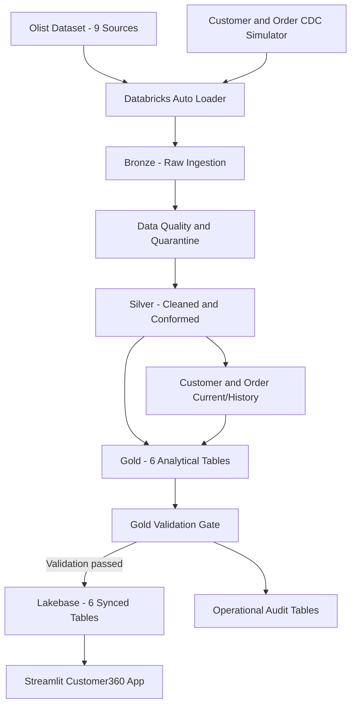

# Customer360 Platform Architecture

## 1. Architecture Overview

The Customer360 CDC Operational Platform implements a medallion lakehouse architecture with operational validation and a PostgreSQL serving layer.



## 2. Ingestion Layer

Nine Olist entities are ingested using Databricks Auto Loader.

The ingestion framework provides schema contracts, source-specific configurations, metadata enrichment, and record hashing.

## 3. Transformation Layer

### Bronze
Raw ingestion with metadata and schema rescue capabilities.

### Silver
Data quality enforcement, deduplication, CDC processing, and current/historical state management.

### Gold
Six analytical datasets supporting customer profiles, orders, revenue analysis, and RFM segmentation.

## 4. CDC Architecture

Customer and order change events are simulated from the Olist dataset.

Customer CDC tracks changes by `customer_unique_id`.

Order CDC models order lifecycle changes.

Current-state tables represent active records, while historical tables preserve earlier versions.

## 5. Operational Architecture

The Databricks workflow contains eight tasks:

1. Execute Lakeflow pipeline.
2. Validate Gold datasets.
3. Refresh customer dimension sync.
4. Refresh order fact sync.
5. Refresh order-item fact sync.
6. Refresh customer revenue sync.
7. Refresh customer RFM sync.
8. Refresh customer-order mapping sync.

The six sync tasks depend on successful Gold validation.

## 6. Serving Architecture

Six Gold datasets are synchronized into Databricks Lakebase.

A Streamlit application queries the PostgreSQL serving layer using short-lived credentials generated through the Databricks SDK.

## 7. Reliability and Recovery

Operational safeguards include:

- Gold validation before synchronization.
- Financial reconciliation.
- CDC historical integrity checks.
- Failure notifications.
- Controlled failure simulation.
- Append-only audit history.
- Repair of failed downstream workflow tasks.

## 8. Design Limitations

The project demonstrates simulated CDC rather than database-log-based CDC.

The repository contains source code and documentation, but infrastructure resources and workspace-specific configurations require separate provisioning.
```
